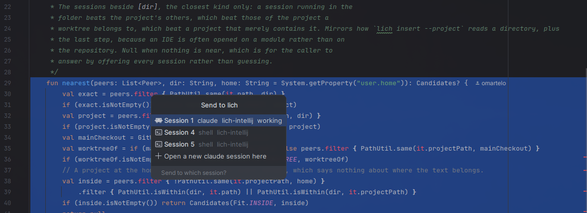
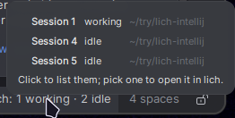
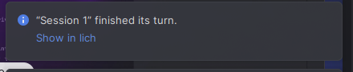

<div align="center">
  <picture>
    <source media="(prefers-color-scheme: dark)" srcset="src/main/resources/META-INF/pluginIcon_dark.svg" />
    
  </picture>
  <h1>lich for IntelliJ IDEA</h1>
  <p><strong>Hand your coding agent what you are looking at, without leaving the editor.</strong></p>
  <p>
    Send a selection, a file, a failed test, an error or a diff to a
    <a href="https://github.com/omartelo/lich">lich</a> session — Claude Code, Codex, opencode or any agent lich
    runs — and keep an eye on your sessions from the status bar.
  </p>
  <p>
    <a href="https://github.com/lichdotdev/lich-intellij/releases"></a>
    
    
    <a href="LICENSE"></a>
  </p>
  
</div>

## Nothing is sent for you

The text lands at the agent's prompt, after whatever you had already typed, and **waits**. You write the question
around it and press Enter. A selection is context; what to ask about it is yours.

````text
src/main/kotlin/App.kt:12-18
```kt
fun main() { ... }
```
why does this run twice on startup?█
````

## What you can send

| Gesture | Where | What lands at the prompt |
| --- | --- | --- |
| **Send Selection to lich** | Editor right-click, or `Ctrl+Alt+Shift+L` | The selected code, headed by its file and lines |
| **Send File to lich** | Editor, editor tab or Project view right-click | The path of the file, or of every file selected |
| **Send problem to lich** | `Alt+Enter` on an error or warning, or right-click it in the Problems view | What the IDE says, over the lines it is about |
| **Send Failure to lich** | Right-click a failed test, class or suite in the test runner | Each failed test with its file, line, message and stack trace |
| **Send Changes to lich** | Right-click changed files in the Commit view | Their diff, for a review or a commit message |
| **Add Comment to lich Review** | Editor right-click, or the file's side of a diff | Nothing yet: the comment joins a batch, and *Send to lich* pastes them all as one list |

Review comments wait in the **lich Review** tool window, which appears with the first one: reword one with a double-click or remove it, add a note
about the change as a whole, and *Send to lich* pastes them as one prompt, the way lich's own review panel does —

```text
Review comments:

- src/main/kotlin/App.kt:12-18 — leaks the listener
- src/main/kotlin/Boot.kt:4 — rename to start
- these are the same bug
```

They live in memory until they are sent: closing the project drops them.

Every session in a list wears its agent's mark — Claude Code, Codex, Antigravity, opencode, oh-my-pi, Cursor — or a
terminal for a shell.

## Your sessions in the status bar

`lich: 1 waiting · 2 working` sits in the status bar, counting the sessions on your project. A balloon tells you
when one **finishes its turn** or **stops on a permission prompt**. Hover for each session's agent, state and folder;
click to list them, and pick one to open its card in lich.

**Show in lich**, on every balloon, brings the lich window forward with that session open.

<p>
  
  &nbsp;
  
</p>

## Which session

The plugin picks the session running on the folder your IDE has open, and asks when that is not obvious:

1. A session running in that very folder is used without asking — a worktree opened in the IDE reaches the session
   in that worktree.
2. Otherwise a session of the project whose root the folder is.
3. A worktree with no session of its own, or a folder that only lies inside a project, is **always asked about**:
   pasting into a session working on another checkout is pasting somewhere wrong. A project at your home
   directory never counts as containing a folder.

When several fit, you pick one and it is remembered for the project. The list always ends with **Open a new session
here**: lich opens one on your folder — opening the folder as a project first if it has to, and a worktree as a
session in that worktree — and the text lands once the agent is up.

A session waiting on a permission prompt is greyed out: text pasted there would answer the dialog.

## Install

1. Download `lich-intellij-<version>.zip` from the [latest release](https://github.com/lichdotdev/lich-intellij/releases).
2. **Settings › Plugins › ⚙ › Install Plugin from Disk…** and pick the zip.

The JetBrains Marketplace listing is on its way.

### Requirements

| | |
| --- | --- |
| **IDE** | IntelliJ IDEA 2024.3 (build 243) or newer |
| **lich** | 0.65.0 or newer, running. 0.66.0 or newer for **Show in lich** to open the session; on 0.65 it brings the window forward |

The plugin is built and tested on IntelliJ IDEA. It depends on the IntelliJ Platform alone, so PyCharm, WebStorm and
the other JetBrains IDEs may run it, but nobody checks that they do — if you use one, fixes are welcome.

## Settings

**Settings › Tools › lich**

| Setting | Default | |
| --- | --- | --- |
| lich command | empty | Empty looks for `lich` on `PATH`, where lich installs it (Homebrew, `/usr/local/bin`, `~/.local/bin`, Scoop) and through your login shell — an IDE started from a launcher does not get your terminal's `PATH` |
| Wrap a selection in a fenced code block | on | |
| Name files with an @ | off | `@src/Main.kt`, which Claude Code and several other agents read as a mention of the file |
| Always ask which session | off | Ask even when one session is the obvious one |
| New sessions run | `claude` | The agent **Open a new session here** starts |

## How it talks to lich

Only through the `lich` command, the part of lich covered by its
[stability promise](https://github.com/omartelo/lich/blob/main/docs/stability.md) and documented in its
[`docs/cli.md`](https://github.com/omartelo/lich/blob/main/docs/cli.md):

```sh
lich sessions --json                                  # who is running, where, and doing what
lich insert --session <id> --json --timeout 10 -      # the text arrives on stdin
lich open --project <dir> [--worktree <branch>] --kind <agent> --json
lich focus --json <id>                                # Show in lich
```

The text goes on stdin, never in an argument: no quoting, no argument-length limit, no Windows command line to get
wrong. lich has no supported way to push a change, so the status bar asks `lich sessions` every 5 seconds.

## Known limits

- On Windows the terminal drops the markers that tell an agent a paste is one paste, so a multi-line selection can
  reach some agents line by line (lich's own `docs/ceilings.md`, under `lich insert`).
- Over 64 KiB lich refuses the text; send the file instead.
- A project reached through a path lich does not know as the project (another mount, WSL from a Windows IDE) has no
  session beside it; the plugin offers every session.

The plugin's own deliberate limits, and the traps they set, are in [`docs/ceilings.md`](docs/ceilings.md).

## Build from source

```sh
mise install                          # Java 21 and Gradle, as mise.toml pins them
./gradlew :core:test                  # the logic, on a plain JDK — no IDE download
./gradlew test buildPlugin            # everything; the zip lands in build/distributions/
./gradlew runIde                      # a sandbox IntelliJ IDEA with the plugin loaded
```

`core/` decides what is sent where — snippets, session matching, finding and running `lich` — with no IntelliJ
dependency; `src/` gathers what the IDE shows and draws the result. Contributors, human or agent, start at
[`CLAUDE.md`](CLAUDE.md).

## License

[AGPL-3.0](LICENSE), like lich.
